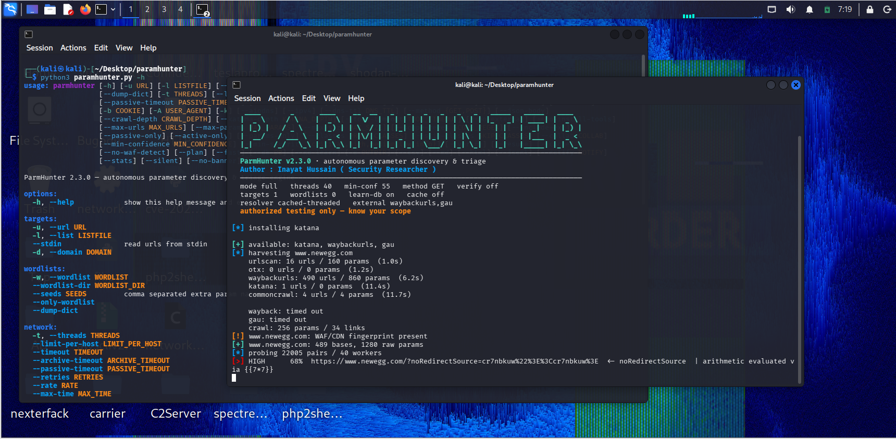
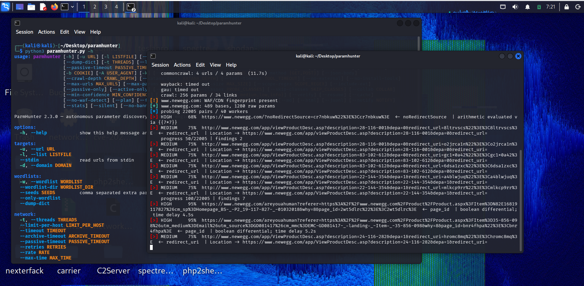

<div align="center">

# ParmHunter

**Autonomous parameter discovery and triage for bug bounty recon.**

Finds the query parameters a target actually accepts, then tells you which ones
behave badly — reflected, erroring, redirecting, traversing, executing.

[](https://python.org)
[](LICENSE)
[]()
[]()

[Features](#features) · [Install](#install) · [Usage](#usage) · [Screenshots](#screenshots) · [Output](#output-layout)

</div>

---

## About

ParmHunter is a recon tool for the parameter-discovery stage of a bug bounty
workflow. It harvests parameter names from every source it can reach — public
archives, `katana`, `waybackurls`, `gau`, live HTML forms, JavaScript bundles,
`robots.txt`, `sitemap.xml`, OpenAPI and GraphQL schemas — merges them with a
categorised built-in dictionary, then probes the target with a baseline-first
differential model to see which parameters actually produce signal.

It is not a fuzzer and not a scanner. It is the step before both: it hands you a
short, ranked, class-sorted list of parameters worth pointing ffuf, dalfox or
Burp at, and it throws away everything that stayed quiet.

Built for people who would rather review 40 promising leads than 40,000 dead
ones.

---

## Screenshots

**Startup**



**During a run**



---

## Features

| | |
|---|---|
| **Autonomous harvesting** | Wayback CDX, Common Crawl, urlscan, OTX, katana, waybackurls, gau, live crawl, JS mining, sitemap, OpenAPI, GraphQL introspection. All sources race in parallel under individual timeouts. |
| **Baseline-first triage** | Every pair gets a clean baseline, then a canary. Status shift, body delta, error signature and reflection are all measured against that baseline — a static "parameter accepted" page produces nothing. |
| **Class-aware probing** | SQLi (error + boolean + time), open redirect, LFI, RCE, SSRF, SSTI, CRLF, IDOR, debug flags. Probes only fire for parameters whose names classify into that class. |
| **Token-Jaccard scoring** | Response change is scored on word-set distance, not raw length, so dynamic pages don't drown you in false positives. |
| **Soft-404 awareness** | Catch-all routes are detected per host and the reporting threshold raised automatically. |
| **Per-class output** | `params/xss.txt`, `params/lfi.txt`, `params/rce.txt` … ready to pipe into other tools. Confirmed hits land in a parallel `findings/` tree. |
| **Learning store** | A local SQLite DB tracks which parameter names actually pay off and promotes them on later runs. |
| **Severity banding** | Findings are rated critical → low; `--min-severity` trims the tail. |
| **Verify pass** | `--verify` re-probes every finding and drops anything that doesn't reproduce. |
| **Resilient networking** | Memoising DNS resolver, per-host socket cap, retry with backoff on 429/5xx, UA rotation for WAF edges. |
| **Reports** | JSONL, CSV, Markdown and a self-contained dark HTML report. Webhook notification on completion. |

---

## Install

Requires Python 3.10+ and `aiohttp`.

```bash
git clone https://github.com/InayatHussain09/parmhunter.git
cd parmhunter
pip install aiohttp
chmod +x parmhunter.py
Optional but recommended — ParmHunter auto-installs these via go install on
first run if Go is present:

bash
go install github.com/projectdiscovery/katana/cmd/katana@latest
go install github.com/tomnomnom/waybackurls@latest
go install github.com/lc/gau/v2/cmd/gau@latest
Skip auto-install with --no-install-tools, or disable external tools entirely
with --no-external.

Usage
bash
# single target
./parmhunter.py -u https://target.com

# list of targets, high concurrency
./parmhunter.py -l urls.txt -t 60

# from stdin
cat urls.txt | ./parmhunter.py --stdin

# full run with reports and a collaborator for OOB SSRF
./parmhunter.py -u https://target.com --collab abc123.oast.pro --html --csv --verify
Bare invocation prints the banner and prompts for targets.

Common recipes
bash
# recon only — harvest names, probe nothing
./parmhunter.py -d target.com --params-only -o recon/

# high-signal classes only, verified, medium and above
./parmhunter.py -u https://target.com --classes sql,rce,lfi,ssrf \
  --min-severity medium --verify

# authenticated, behind a proxy, rate limited
./parmhunter.py -u https://target.com -b "SESSION=abc" \
  --proxy http://127.0.0.1:8080 --rate 25

# see the probe plan without sending anything
./parmhunter.py -u https://target.com --plan
How it works
harvest ──▶ merge ──▶ rank ──▶ baseline ──▶ canary ──▶ class probes ──▶ score ──▶ report
Harvest — all sources run concurrently, each timeboxed. A dead archive
cannot stall the run.
Merge — URLs are normalised to base+parameter pairs, deduplicated,
scoped to the apex domain.
Rank — heuristic score plus learned hit rate from the local DB.
Baseline — one clean request per base URL, cached and reused for every
parameter on it. Soft-404s detected per host.
Canary — a unique marker is injected; reflection, encoding and body
change are measured against the baseline.
Class probes — only for matching parameter classes.
Score — signals aggregate per class, capped, filtered by confidence and
severity.
Report — only survivors are written.
Output layout
output/
├── <host>/
│   ├── params/
│   │   ├── xss.txt              # ready-to-pipe candidate URLs
│   │   ├── sqli.txt
│   │   ├── lfi.txt
│   │   ├── rce.txt
│   │   ├── ssrf.txt
│   │   ├── ssti.txt
│   │   ├── open-redirect.txt
│   │   ├── crlf.txt
│   │   ├── idor.txt
│   │   └── debug-flag.txt
│   ├── findings/
│   │   └── <class>.txt          # confirmed: url, confidence, evidence
│   ├── findings.jsonl
│   ├── findings.csv
│   ├── report.md
│   ├── report.html
│   └── params.txt               # all candidates, unscoped
└── state.json                   # resume state
Parameters are written with a class-appropriate sample value, so the files work
directly as fuzzing targets:

Class	Sample
rce	;id
lfi	../../etc/passwd
ssti	{{7*7}}
ssrf, open-redirect	https://example.com
sqli	1'
everything else	FUZZ
Detection classes
Class	Method	Confidence
rce	;id output match, blind sleep timing	80 / 50
open-redirect	canary in Location, canary in body	75 / 40
lfi	/etc/passwd, win.ini signatures	72
ssrf	metadata endpoint, collaborator echo, localhost delta	70 / 65 / 35
ssti	arithmetic evaluation ({{7*7}} → 49)	68
xss	unencoded break-out, raw reflection, HTML context	62 / 25 / 12
crlf	injected response header	62
sqli	DB error signature, boolean differential, time delay	55 / 45 / 50
idor	body variance across object values	38
debug-flag	behaviour change on debug=1	32
Selected flags
Flag	Purpose
-u, -l, -d, --stdin	target input
-w, --wordlist-dir, --seeds	extra dictionaries
-t, --limit-per-host, --rate	concurrency and pacing
--collab	collaborator domain for OOB SSRF
--classes, --skip-classes	restrict detector set
--min-confidence, --min-severity	output trimming
--verify, --resume, --cache	accuracy and repeat runs
--params-only, --plan	recon without probing
--fast	speed preset
--csv, --md, --html, --notify	reporting
--no-external, --no-install-tools	tool control
Full list: ./parmhunter.py -h.

Notes and limitations
idor and debug-flag are hints, not confirmations. They flag variance
that deserves a human look.
--collab is the only reliable SSRF check. Without it, SSRF is inference from
metadata and localhost behaviour.
--verify roughly doubles request count. Pair it with --min-severity high
on large runs.
Single-page apps that render everything client-side will yield little from
static crawling; katana's JS mode helps but won't cover everything.
A WAF fingerprint warning means results may be thinner than reality — try
--rate and a custom -A.
Disclaimer
Use ParmHunter only against systems you are authorised to test. Unauthorised
scanning is illegal in most jurisdictions. The author accepts no liability for
misuse.

Author
Inayat Hussain — Security Researcher
Bug bounty · offensive security · tooling

Original Bash concept and Python rewrite by the same author.

If this helped, star the repo and pass it to someone starting out.

<div align="center"><sub>MIT licensed · built for authorised testing</sub></div> ```
